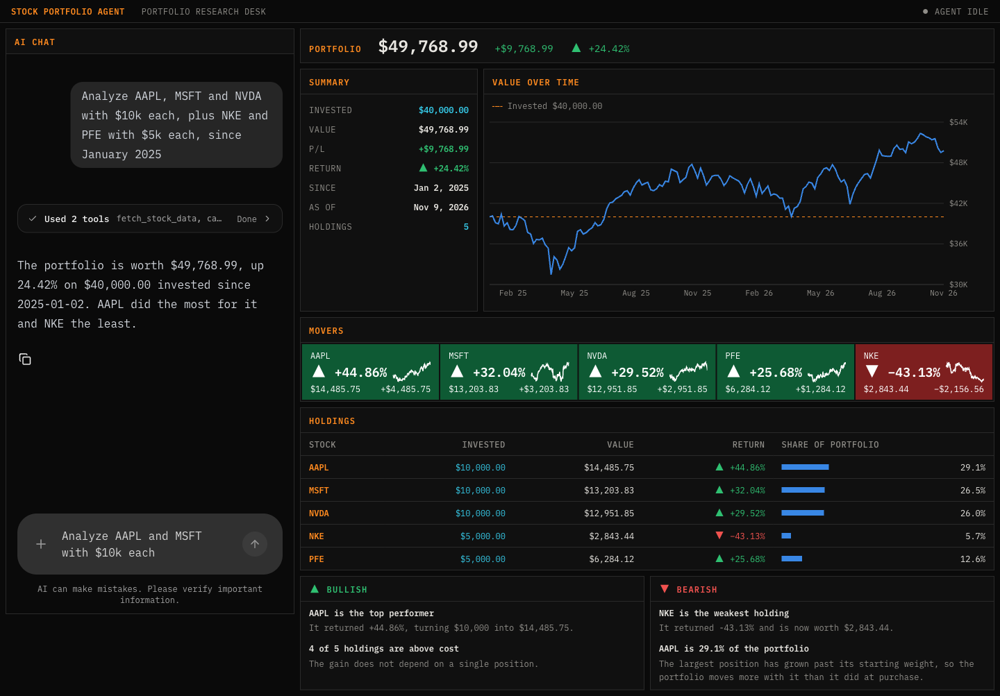
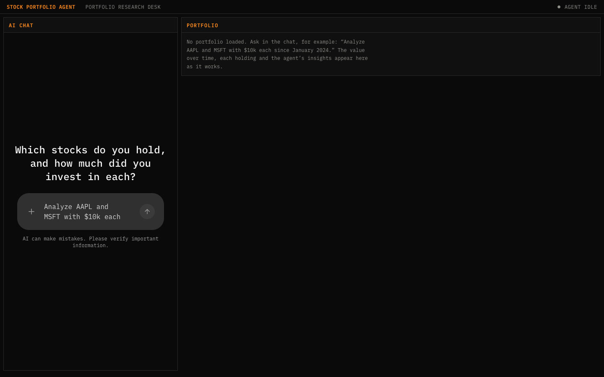
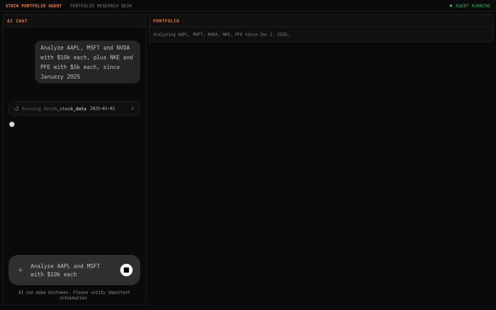
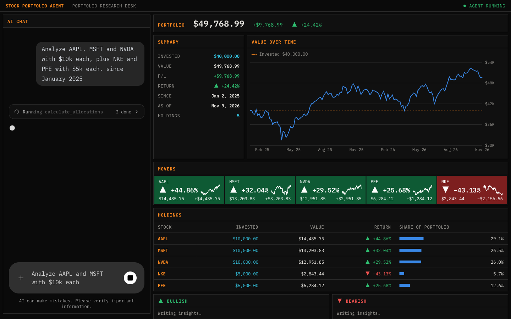
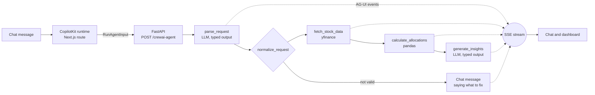

# Stock Portfolio Agent


An AI agent that analyzes a stock portfolio **while you watch it work**. You describe your holdings in plain language ("AAPL and MSFT with $10k each since January 2025"). A **CrewAI Flow** parses the request, fetches prices, computes the value and allocation of every position and writes insights. Each step is streamed to the browser over the **AG-UI protocol**, so the chat shows the tool calls as they run and the dashboard fills in panel by panel instead of appearing at the end.



The split of work is deliberate: **the language model reads and writes, pandas does the arithmetic.** The model turns the chat message into a typed request and turns the finished figures into commentary. It never produces a number that reaches the dashboard.

- **Backend:** [FastAPI](https://fastapi.tiangolo.com/) serving a [CrewAI](https://github.com/crewAIInc/crewAI) Flow, with [yfinance](https://github.com/ranaroussi/yfinance) and [pandas](https://pandas.pydata.org/) for market data and analysis.
- **Frontend:** [Next.js](https://nextjs.org/) and [React](https://react.dev/) with [CopilotKit](https://github.com/CopilotKit/CopilotKit) for the chat and agent state, and [Recharts](https://recharts.org/) for the chart.
- **Between them:** AG-UI events over server-sent events. No polling and no custom websocket.

## A run, step by step

**1. Ask.** The app opens with an empty dashboard and a chat. The request is free text: tickers or company names, amounts such as `$10k`, and an optional start date.



**2. The agent parses the request and starts fetching.** As soon as the request is understood, the dashboard names the tickers and the start date it will use, and the status in the top bar turns to *Agent running*. The `fetch_stock_data` tool call appears in the chat with its arguments while yfinance is still downloading.



**3. Numbers arrive before the commentary.** When `calculate_allocations` finishes, the backend sends the analysis as shared state and the dashboard renders: total value and return, value over time against the amount invested, one tile per holding with its own sparkline, and the holdings table. The insight panels still say *Writing insights…* because that model call has not returned yet.



**4. Insights and summary complete the run.** The model receives only the computed figures and returns bullish and bearish insights plus a short summary, which is posted to the chat. The status returns to *Agent idle*. This is the screenshot at the top of this page.

**Honest reading.**

- **The screenshots were captured with the language model stubbed.** No OpenAI key was available on the capture machine, so the two model calls were replaced with a stand-in. Everything else is the real application: the prices are live yfinance data, the figures come from the real pandas code, and the events travel through the real FastAPI, CopilotKit and Next.js path. The insight text in the screenshots was generated from those figures by the stand-in, not by a model.
- **The path through a real OpenAI model has not been exercised yet.** It is covered by tests with a fake client that returns the same typed objects, but a first real run may still surface a provider-specific issue with structured output.
- **This is not investment advice.** The insights are educational commentary on past prices, and the prompt tells the model not to recommend buying or selling.

## How it works



1. **Receive.** The chat sends the conversation to the CopilotKit runtime, a Next.js route handler, which forwards it to the backend as an AG-UI `RunAgentInput`. The browser never talks to the Python server directly, so there is no CORS setup and the backend URL stays server-side.
2. **Parse.** The first Flow step asks the model for a `PortfolioRequest` (a list of ticker and amount pairs, and an optional date) as structured output. It sees the last 10 chat messages, so a follow-up such as "now add NVDA" has context.
3. **Validate.** `normalize_request` treats the model's answer as untrusted input: ticker symbols must match a strict pattern, amounts must be finite and positive, duplicates are merged, at most 10 stocks are allowed, and the date must be in the past. Without a date, the analysis covers the last 365 days. Anything invalid becomes a chat message that says what to fix.
4. **Fetch.** `fetch_stock_data` downloads daily adjusted closes from yfinance in a worker thread, so the event loop keeps streaming. A ticker with no data stops the run with a message naming it.
5. **Calculate.** `calculate_allocations` buys every position on the first trading day on which all tickers have a price, then tracks each holding's value. It returns totals, per-holding return and share of the portfolio, and a history downsampled to about 120 points for the chart.
6. **Narrate.** The last step gives the model the computed figures, without the price history, and asks for a summary and three to six insights labelled bullish or bearish.
7. **Stream.** Every step emits AG-UI events into a queue that FastAPI drains as server-sent events. If the browser disconnects, the workflow task is cancelled.

### The event stream

A successful run always produces this sequence. The backend test asserts it event by event.

| Event | Sent when | What the UI does |
| --- | --- | --- |
| `RUN_STARTED` | The request arrives | Status turns to *Agent running* |
| `STATE_SNAPSHOT` (request) | The request is parsed and valid | Dashboard shows "Analyzing AAPL, MSFT… since…" |
| `TOOL_CALL_START` / `ARGS` / `END` | `fetch_stock_data` begins | Chat shows the tool call as running, with its arguments |
| `TOOL_CALL_RESULT` | Prices are downloaded | Tool call is marked done |
| `TOOL_CALL_START` / `ARGS` / `END` / `RESULT` | `calculate_allocations` runs | Second tool call in the chat |
| `STATE_SNAPSHOT` (request, analysis) | The figures are ready | Summary, chart, movers and holdings render |
| `STATE_SNAPSHOT` (request, analysis, insights) | The model returns insights | Bullish and bearish panels fill in |
| `TEXT_MESSAGE_START` / `CONTENT` / `END` | Right after | Summary appears as a chat message |
| `RUN_FINISHED` | The flow ends | Status returns to *Agent idle* |

A problem the user can fix (no tickers, an unknown ticker, a missing API key) ends with a `TEXT_MESSAGE` that explains it, followed by `RUN_FINISHED`. An unexpected failure ends with `RUN_ERROR` and a generic message; the detail goes to the backend log, not to the browser.

## What makes this project strong for AI Engineer roles

| Skill | Where to look |
| --- | --- |
| **A streaming agent protocol, end to end.** AG-UI events emitted by hand from Python, encoded as SSE, consumed by CopilotKit and rendered as chat messages, tool-call cards and shared state. | [stock_analysis.py](agent/stock_analysis.py), [main.py](agent/main.py), [route.ts](frontend/src/app/api/copilotkit/%5B%5B...slug%5D%5D/route.ts) |
| **Workflow orchestration with CrewAI Flows.** Four steps chained with `@start` and `@listen` over a typed Pydantic state, with blocking I/O moved off the event loop. | [stock_analysis.py](agent/stock_analysis.py) |
| **Model output treated as untrusted input.** Structured output into Pydantic models, then a separate validation step with explicit limits before anything reaches yfinance. | `normalize_request` in [stock_analysis.py](agent/stock_analysis.py) |
| **The model kept away from arithmetic.** Every figure on screen comes from pandas. The model parses the request and writes commentary from figures it is handed. | `analyze` and `generate_insights` in [stock_analysis.py](agent/stock_analysis.py) |
| **Agent state driving the interface.** `STATE_SNAPSHOT` events feed `useAgent`, and the dashboard renders whatever part of the state has arrived, which is what makes the run visible step by step. | [page.tsx](frontend/src/app/page.tsx), [portfolio.tsx](frontend/src/app/portfolio.tsx) |
| **Failures a user can act on.** Fixable problems become chat messages, unexpected ones a generic `RUN_ERROR`. A tool call is always closed, even when its work raises, and a client disconnect cancels the run. | `_tool` and `run_analysis` in [stock_analysis.py](agent/stock_analysis.py), [main.py](agent/main.py) |
| **Tested offline.** 11 tests with a fake model and fixed prices: the calculation, every validation rule, and the exact event sequence of a full run through the HTTP endpoint. | [test_stock_analysis.py](agent/test_stock_analysis.py) |

## Quickstart

Requirements: [uv](https://docs.astral.sh/uv/), Node.js 20 or later, and an OpenAI API key. uv installs a compatible Python (3.11 to 3.13) if you do not have one.

```bash
uv sync
npm --prefix frontend install
cp agent/.env.example agent/.env          # then put your OpenAI key in it
cp frontend/.env.example frontend/.env
uv run pytest                             # offline, uses a fake model
```

Start the backend:

```bash
uv run python agent/main.py
```

In another terminal, start the frontend:

```bash
npm --prefix frontend run dev
```

Open `http://localhost:3000` and ask for an analysis.

Environment variables:

| File | Variable | Purpose |
| --- | --- | --- |
| `agent/.env` | `OPENAI_API_KEY` | Required. Used for the two model calls. |
| `agent/.env` | `OPENAI_MODEL_NAME` | Optional. Overrides CrewAI's default model. |
| `frontend/.env` | `NEXT_PUBLIC_CREWAI_URL` | Where the Next.js server reaches the agent. Defaults to `http://127.0.0.1:8000/crewai-agent`. |

The frontend needs no OpenAI key: every model call happens in the backend.

## Using it

Things to try in the chat:

- `Analyze AAPL and MSFT with $10k each` uses the last 365 days.
- `I put 5k in Nvidia and 2,500 in Coca-Cola in March 2024` resolves company names and the date.
- `Now add $3k of AMZN` works as a follow-up, because the model sees the recent conversation.

Reading the dashboard:

- **Portfolio and Summary** show the total value, the gain or loss, and the period. *Since* is the first day on which every ticker had a price, which can be later than the date you asked for.
- **Value over time** plots the portfolio value. The dashed line is the amount invested, so the line above it means a gain.
- **Movers** shows one tile per holding, ordered by return and coloured by direction, with that holding's own sparkline.
- **Holdings** is the same data as a table, with each position's share of the current portfolio value.
- **Bullish and Bearish** hold the model's insights.

## Design decisions

| Decision | Why |
| --- | --- |
| The model parses and narrates; pandas calculates | A model that does arithmetic is occasionally wrong in ways nobody notices. Keeping it out of the numbers means every figure on screen can be traced to a price. |
| Structured output, then a separate validation step | Structured output guarantees the shape of the answer, not its sense. Tickers, amounts, dates and the number of positions are checked in code before any network call is made with them. |
| Full state snapshots instead of JSON Patch deltas | The state is small and changes three times per run. Snapshots are easier to reason about and to test than a patch stream. |
| Tool calls with results emitted by the backend | The chat shows what the agent is doing and with which arguments, and the frontend never has to execute anything. |
| Two kinds of failure | "Unknown ticker" is the user's to fix and belongs in the chat. A stack trace is not, and its detail should not reach the browser. |
| The frontend talks to its own route, not to Python | The CopilotKit runtime proxies to the agent, so there is no CORS configuration and the browser never learns the backend address. |
| Every position bought on the first common trading day | Tickers can have different calendars or listing dates. One purchase date keeps the positions comparable. |
| Direction shown with an arrow and a sign, not only colour | Green and red are the hardest pair for colour-blind readers, so gain and loss never depend on colour alone. |
| CrewAI's default model unless overridden | No model name is hard-coded, so the project does not go stale when a model is retired. |

## Repository structure

```
agent/
  main.py                 FastAPI app: POST /crewai-agent streams AG-UI events as SSE
  stock_analysis.py       the CrewAI Flow, request validation, pandas analysis, event emission
  test_stock_analysis.py  offline tests: calculation, validation, full event sequence
  .env.example            OPENAI_API_KEY
frontend/
  src/app/
    page.tsx              CopilotKit provider, chat and layout
    portfolio.tsx         dashboard: summary, chart, movers, holdings, insights
    layout.tsx            fonts and metadata
    globals.css           colour tokens and the chat theme
    api/copilotkit/[[...slug]]/route.ts   CopilotKit runtime, proxies to the agent
  .env.example            NEXT_PUBLIC_CREWAI_URL
docs/screenshots/         the images in this README
pyproject.toml            Python dependencies and pytest settings
```

Not committed: `agent/.env`, `frontend/.env`, `.venv/`, `node_modules/` and `.next/`.

## Troubleshooting

- **The chat answers "OPENAI_API_KEY is not set".** Add the key to `agent/.env` and restart the backend. The file is read once, at startup.
- **The chat does nothing when you press Enter.** Open the app at `http://localhost:3000`, not `http://127.0.0.1:3000`. The Next.js development server blocks its scripts on origins it does not expect, so the page renders but never becomes interactive.
- **A run stops without a result.** An unexpected error ends the run with `RUN_ERROR`. The terminal running `agent/main.py` has the traceback. A wrong or expired API key ends up here.
- **"No price data found for: …"** yfinance does not know the symbol, or it has no prices since the start date. Exchange suffixes are needed for stocks listed outside the US, such as `PETR4.SA`.
- **`uv sync` installs another Python.** Expected when your default is Python 3.14 or newer: the project pins `<3.14`, and uv downloads a compatible version.
- **A warning about `identifyUser` in the Next.js log.** Harmless here. CopilotKit's thread listing is not used and stays disabled.

## Limitations

- **Not yet run against a real model.** See the honest reading above.
- **Past prices only.** There is no benchmark comparison, no risk measure such as volatility or drawdown, and no forecast.
- **Simplified money.** Fractional shares, no fees or taxes, and adjusted closes, which fold dividends into the price. Amounts are treated as US dollars, so a ticker quoted in another currency is not converted.
- **yfinance is an unofficial data source.** It can rate-limit, change or return gaps.
- **The summary arrives as one message.** Steps stream live, but the model's text is not streamed token by token.
- **Follow-up questions get a new analysis, not a conversation.** A message that is not a portfolio request receives a fixed hint about what to ask.
- **Nothing is stored.** Reloading the page clears the chat and the dashboard.
- **Dark theme only, and built for desktop.** The layout stacks on narrow screens, but phone widths were not tested.

## Roadmap

1. Run against a real model and recapture the screenshots.
2. Compare the portfolio with a benchmark such as the S&P 500.
3. Stream the summary token by token.
4. Answer follow-up questions from the computed figures.
5. Add a browser test that drives the full run.

## Tech stack

Python 3.11 to 3.13, [CrewAI](https://github.com/crewAIInc/crewAI) 1.15 (Flows), [FastAPI](https://fastapi.tiangolo.com/) and [Uvicorn](https://www.uvicorn.org/), the [AG-UI protocol](https://github.com/ag-ui-protocol/ag-ui) Python SDK, [Pydantic](https://docs.pydantic.dev) v2, [yfinance](https://github.com/ranaroussi/yfinance), [pandas](https://pandas.pydata.org/), pytest and uv. [Next.js](https://nextjs.org/) 16, [React](https://react.dev/) 19, [CopilotKit](https://github.com/CopilotKit/CopilotKit) 1.85, [Recharts](https://recharts.org/) 3, [Tailwind CSS](https://tailwindcss.com/) 4 and TypeScript.

## License

[MIT](LICENSE)
